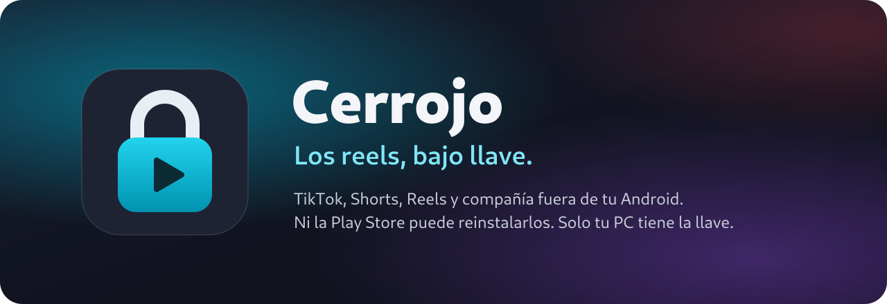
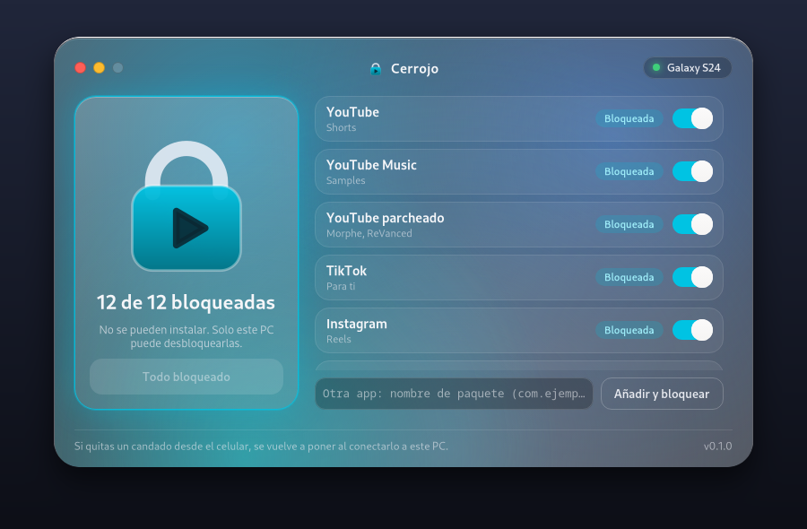
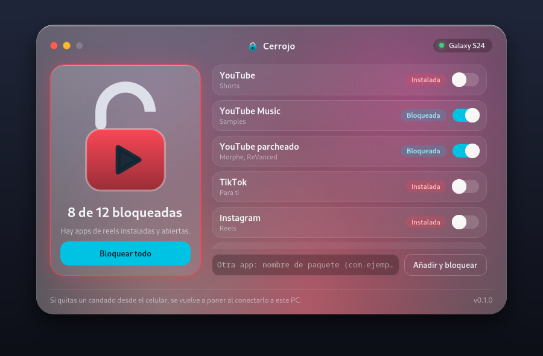
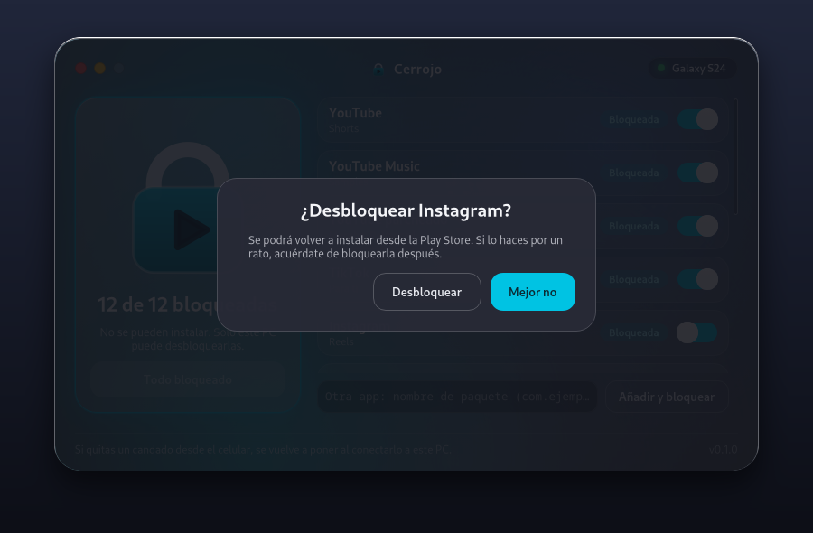
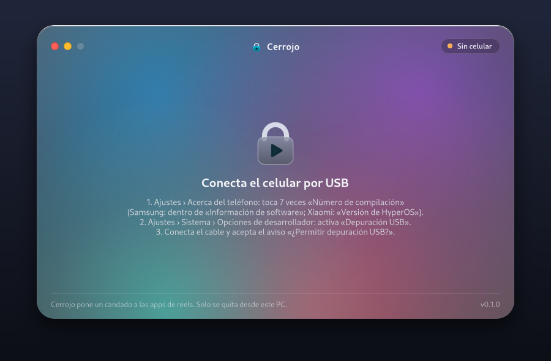

<p align="center">
  
</p>

<p align="center"><strong>Español</strong> · <a href="README.en.md">English</a></p>

<p align="center">
  <a href="https://github.com/sthifen/cerrojo/releases/latest/download/Cerrojo-x86_64.AppImage"></a>
  <a href="https://github.com/sthifen/cerrojo/releases/latest/download/Cerrojo-windows-x86_64.zip"></a>
  <a href="https://github.com/sthifen/cerrojo/releases/latest/download/Cerrojo-macos-arm64.zip"></a>
  <a href="https://github.com/sthifen/cerrojo/releases/latest"></a>
  
</p>

---

## Cinco minutos de reels que se vuelven dos horas

Abres el celular para ver un mensaje y, sin saber cómo, llevas una hora deslizando videos verticales. Las
apps de "bienestar digital" no sirven: el límite se quita con un toque, la app se reinstala en diez segundos y
tu fuerza de voluntad a las dos de la mañana no es la misma que al mediodía.

**Cerrojo cambia las reglas.** Conectas el celular al PC, pulsas un botón y TikTok, YouTube Shorts, Instagram
Reels y compañía desaparecen. Lo importante es que **no puedes volver a instalarlos desde el celular**: ni desde
la Play Store, ni desde otra tienda, ni con un APK descargado. La llave se queda en tu PC.

<p align="center"></p>

## Lo que hace

- 🔒 **Bloqueo de verdad, sin root.** No es un temporizador que se salta: Android simplemente no deja instalar la app.
- 🛍️ **La Play Store sigue funcionando** para todo lo demás. Bloqueas los reels, no el teléfono.
- 💻 **Solo el PC desbloquea.** En el celular no hay ningún ajuste, contraseña ni botón que lo deshaga.
- 🔁 **Se repara solo.** Si quitas un candado desde el celular, Cerrojo lo vuelve a poner en cuanto lo conectas al PC.
- 🎯 **Un toque, todo listo.** YouTube, YouTube Music, TikTok (y Lite), Instagram (y Lite), Threads, Facebook (y Lite),
  Snapchat, Pinterest, Kwai, Likee, Snaptube y los YouTube parcheados (ReVanced, Morphe).
- ➕ **Cualquier otra app** se añade escribiendo su nombre de paquete.
- 📱 **Varios equipos**: el celular, la tablet, el de tu hermano… cada uno recuerda su lista.
- 🪶 **Nada que instalar en el celular.** Ni apps espía ni permisos raros: solo `adb`, la herramienta oficial de Android.
- 🆓 Libre, gratis y sin cuentas, anuncios ni telemetría.

| Cuando aún hay reels instalados | Desbloquear cuesta un poco, a propósito |
|---|---|
|  |  |

## Descargar

| Sistema | Descarga | Notas |
|---|---|---|
| **Linux** x86_64 | [Cerrojo-x86_64.AppImage](https://github.com/sthifen/cerrojo/releases/latest/download/Cerrojo-x86_64.AppImage) | Cualquier distro reciente. Dale permiso de ejecución y ábrela. |
| **Linux** ARM64 | [Cerrojo-aarch64.AppImage](https://github.com/sthifen/cerrojo/releases/latest/download/Cerrojo-aarch64.AppImage) | Raspberry Pi 4/5 con sistema de 64 bits, portátiles ARM. |
| **Windows** 10/11 | [Cerrojo-windows-x86_64.zip](https://github.com/sthifen/cerrojo/releases/latest/download/Cerrojo-windows-x86_64.zip) | Portátil: descomprime y abre `Cerrojo.exe`. |
| **macOS** 12+ (Apple Silicon) | [Cerrojo-macos-arm64.zip](https://github.com/sthifen/cerrojo/releases/latest/download/Cerrojo-macos-arm64.zip) | La primera vez: clic derecho › **Abrir** (no está firmada por Apple). |

**Instalación en Linux con una línea** (la añade al menú de aplicaciones):

```sh
curl -fsSL https://raw.githubusercontent.com/sthifen/cerrojo/main/packaging/install.sh | sh
```

> Windows y macOS se compilan automáticamente pero se han probado menos que Linux. Si algo falla,
> [abre un issue](https://github.com/sthifen/cerrojo/issues) y lo arreglamos.

## Tutorial: preparar el celular y adb (una sola vez)

Cerrojo habla con el celular mediante **adb** (Android Debug Bridge), la herramienta oficial de Google para
desarrolladores. Hay que hacer dos cosas: activar la depuración USB en el celular e instalar adb en el PC.

### 1. Activa las opciones de desarrollador en el celular

1. Abre **Ajustes › Acerca del teléfono**.
2. Toca **7 veces** seguidas **Número de compilación** hasta que diga *«Ahora eres desarrollador»*.
   - **Samsung**: Ajustes › Acerca del teléfono › **Información de software** › Número de compilación.
   - **Xiaomi / Redmi / POCO**: Ajustes › Sobre el teléfono › **Versión de HyperOS** (o MIUI).
   - **Motorola, Pixel, Nokia**: Ajustes › Acerca del teléfono › Número de compilación.
   - **Huawei / Honor**: Ajustes › Acerca del teléfono › Número de compilación.
3. Si te pide el PIN, escríbelo.

### 2. Activa la depuración USB

1. Ve a **Ajustes › Sistema › Opciones de desarrollador** (en Samsung y Xiaomi aparecen al final de Ajustes).
2. Activa **Depuración USB**.
3. **Xiaomi**: activa también **Depuración USB (ajustes de seguridad)**; si no, Cerrojo no podrá instalar los candados.

### 3. Instala adb en el PC

| Sistema | Cómo |
|---|---|
| **Windows** | En PowerShell: `winget install Google.PlatformTools`. Con un **Samsung**, instala también el [driver USB de Samsung](https://developer.samsung.com/android-usb-driver). |
| **macOS** | Con [Homebrew](https://brew.sh): `brew install android-platform-tools` |
| **Fedora** | `sudo dnf install android-tools` |
| **Ubuntu / Debian / Mint** | `sudo apt install adb` |
| **Arch / Manjaro** | `sudo pacman -S android-tools` |

Si prefieres no usar la terminal, descarga
[platform-tools](https://developer.android.com/tools/releases/platform-tools) de Google y descomprímelo **junto
a Cerrojo** (en Windows, al lado de `Cerrojo.exe`): Cerrojo lo encuentra solo.

### 4. Conecta y acepta

1. Conecta el celular con un cable USB que transmita datos (algunos solo cargan).
2. En el celular sale **«¿Permitir depuración USB?»**: marca **Permitir siempre desde este equipo** y toca **Permitir**.
3. Abre Cerrojo: verás el nombre de tu celular arriba a la derecha.

<p align="center"></p>

Cerrojo te muestra los mismos pasos en pantalla mientras no detecta el celular.

## Cómo funciona

Android no deja instalar una app si ya hay **otra con el mismo nombre de paquete y una firma distinta**. Cerrojo
aprovecha esa regla:

1. **Desinstala la app** (por ejemplo, `com.zhiliaoapp.musically`, TikTok).
2. **Instala en su lugar un candado**: una app vacía, sin icono ni código, con ese mismo nombre de paquete,
   firmada con una clave que se genera en tu PC y nunca sale de él.
3. **La suspende** con `cmd package suspend`, que solo se puede revertir por adb.

Para Android, TikTok "ya está instalada", así que la Play Store solo ofrece *Desinstalar*, y cualquier APK de
TikTok falla por firma distinta. Las apps que vienen de fábrica (como YouTube en casi todos los Android) no se
pueden reemplazar, así que se dejan instaladas pero **suspendidas**: al abrirlas, Android dice que están en pausa.

Los candados se generan dentro de Cerrojo, sin necesitar el SDK de Android: el manifiesto, el zip y la firma
APK v2 están hechos en Rust (`src/apk.rs`).

## Preguntas

**¿Necesita root?** No. Todo se hace con los permisos normales de adb.

**¿Puedo saltármelo desde el celular?** Hay una sola forma: en la ficha de la app en la Play Store, tocar
*Desinstalar* (quita el candado) y luego instalar la app real. Cuesta varios pasos conscientes, que es justo lo que
corta el impulso, y **Cerrojo vuelve a poner el candado la próxima vez que conectes el celular al PC**. Si buscas
algo imposible de saltar, ninguna app sin root lo es; Cerrojo busca que sea incómodo.

**¿Y desde el navegador?** Cerrojo bloquea apps. Para que los sitios web tampoco te atrapen, combínalo con un DNS
con bloqueo, como [NextDNS](https://nextdns.io) (gratis): en *Parental Control › Apps* bloqueas YouTube, TikTok e
Instagram y lo pones en **Ajustes › Conexiones › DNS privado** del celular.

**¿Pierdo mis datos?** Al bloquear una app se desinstala, así que su contenido local se borra (tus cuentas siguen
en los servidores de cada red social). Al desbloquearla, se instala de nuevo desde la Play Store.

**¿Qué pasa si restablezco el celular?** Se va todo, candados incluidos. Conéctalo a Cerrojo y pulsa *Bloquear todo*.

**¿Puedo usarlo desde la terminal?**

```sh
cerrojo estado                      # qué está bloqueado
cerrojo bloquear com.zhiliaoapp.musically
cerrojo desbloquear com.pinterest
cerrojo bloquear PAQUETE -s SERIAL  # con varios equipos conectados
```

## Compilar

```sh
# Fedora: sudo dnf install gtk4-devel   ·   Ubuntu: sudo apt install libgtk-4-dev
cargo build --release
./target/release/cerrojo
```

Rust estable y GTK 4.6 o más nuevo. Las versiones se publican solas con GitHub Actions al subir una etiqueta `vX.Y.Z`.

## Licencia

[MIT](LICENSE). Úsalo, compártelo y mejóralo.

<p align="center"><sub>Hecho por alguien a quien los reels también le estaban ganando.</sub></p>
